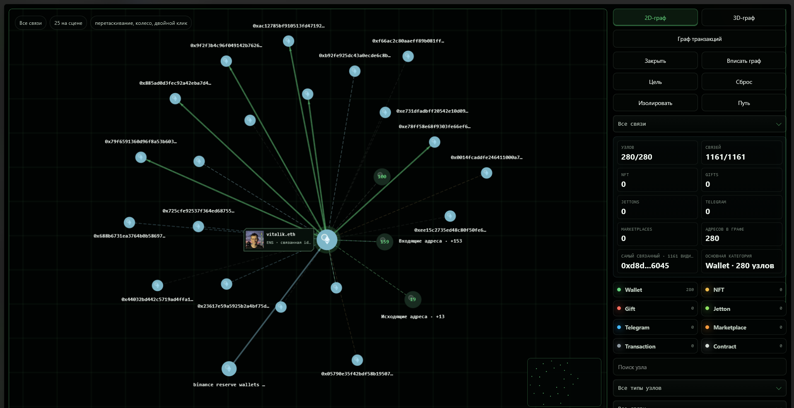
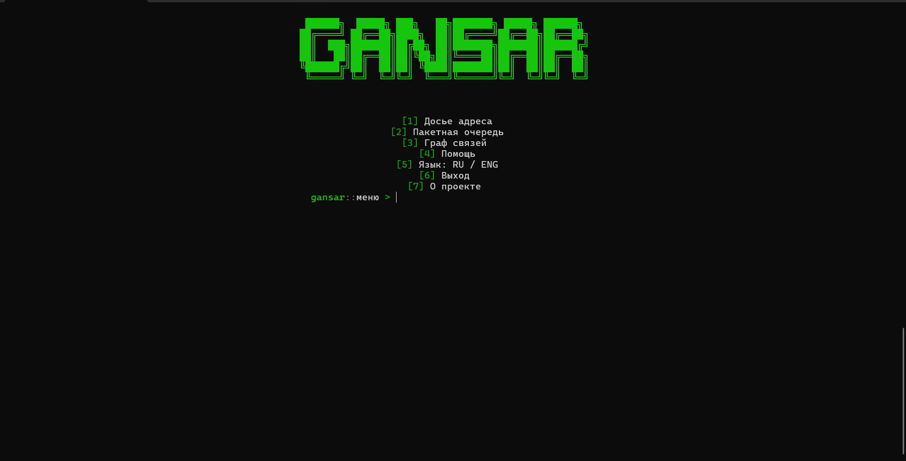
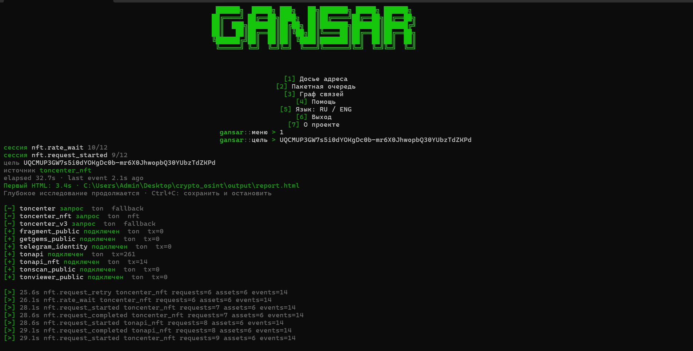
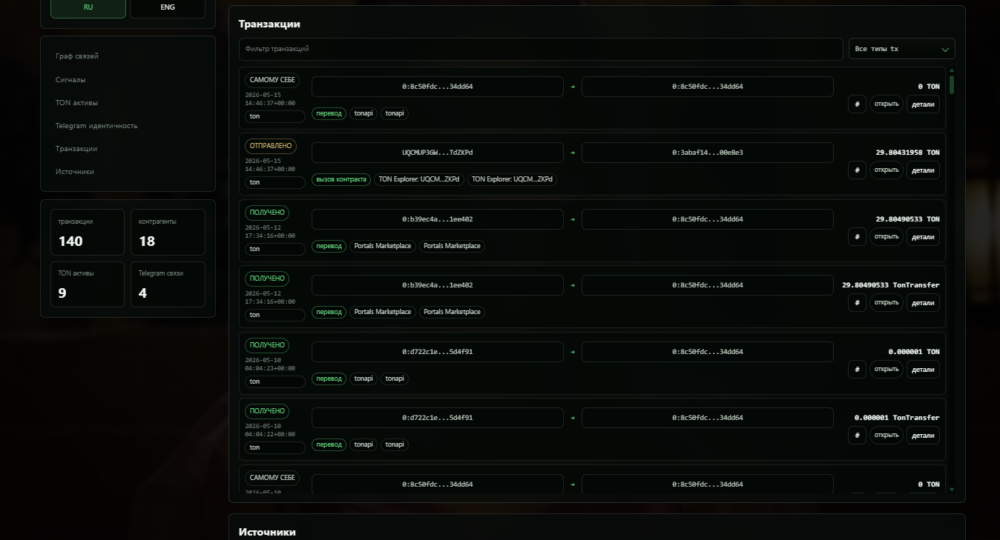
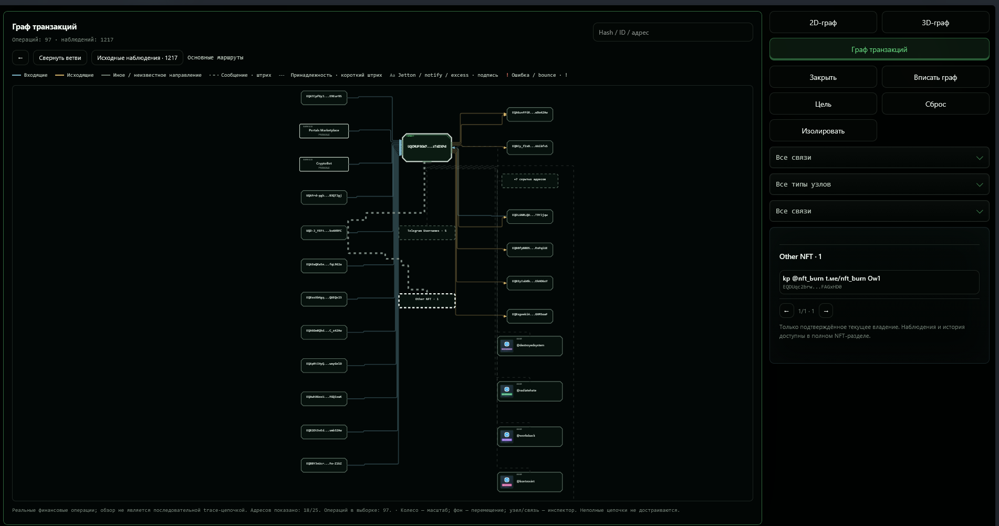
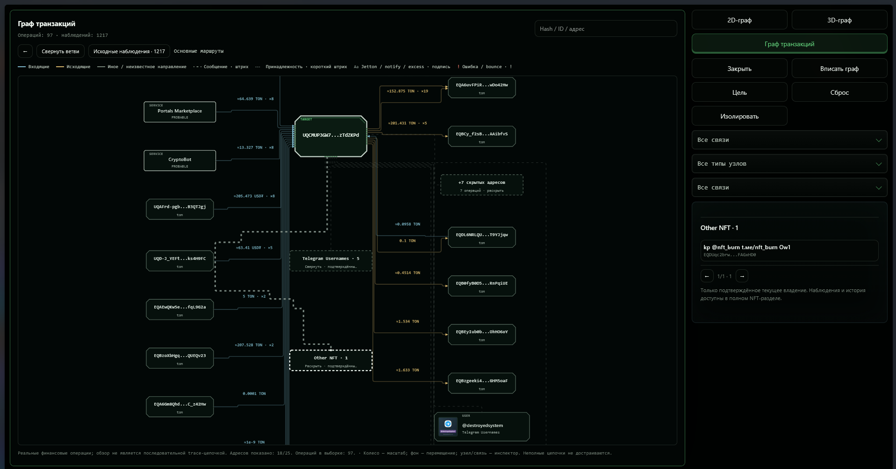
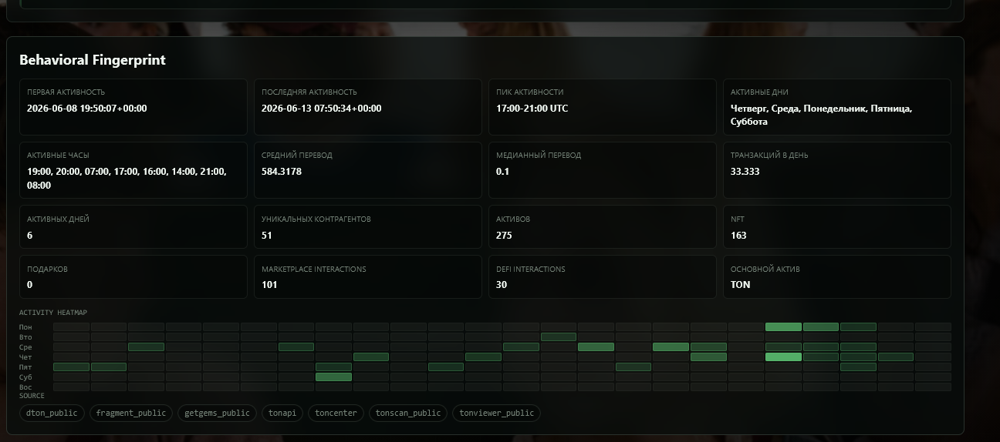
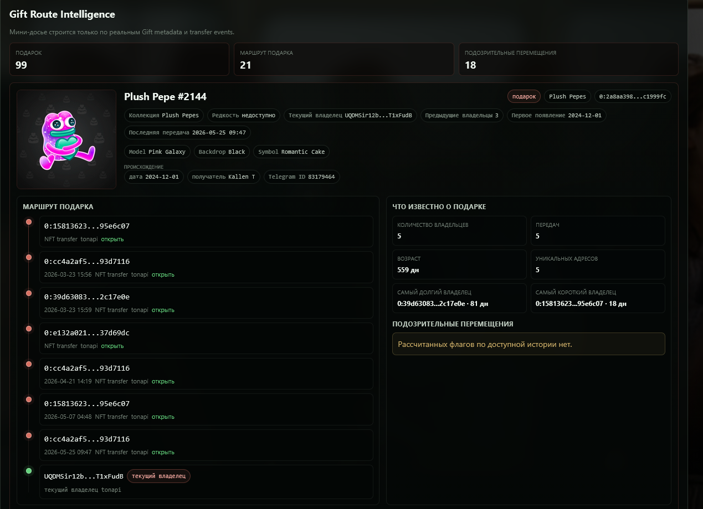
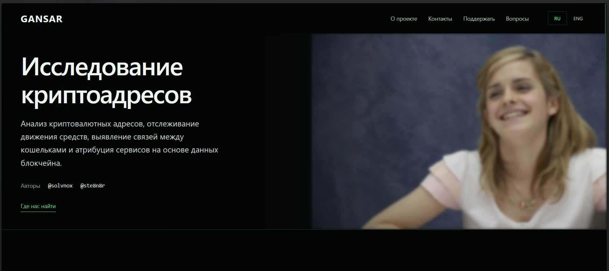
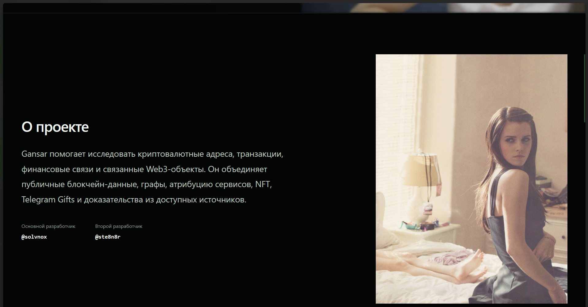

# Gansar

Gansar — локальный инструмент блокчейн-разведки. Введите криптоадрес, ENS-имя или идентификатор TON NFT: программа соберёт доступные сведения из публичных источников и создаст интерактивный HTML-отчёт с транзакциями, активами, графами и доказательствами.

Отчёт помогает проследить движение средств, проверить связь с сервисом и отделить установленный факт от аналитической гипотезы. Исходные наблюдения, источники и ограничения сохраняются вместе с результатом.

## Сеть связей

На сохранённом кадре Ethereum-исследования видны центральный адрес, контрагенты и раскрываемые группы. Рядом с целью показана отдельная ENS-карточка; справа — фильтры, счётчики и действия над графом.



## Возможности

- **Исследование адресов.** Балансы, транзакции, контрагенты, активы и повторяющиеся взаимодействия. Одиночный поиск и пакетная очередь используют максимальную поддерживаемую глубину в пределах бюджета запросов и доступности источников.
- **Графы и история.** 2D-сеть, 3D-граф, дерево транзакций, поиск, фильтры, раскрываемые группы и инспектор. Денежные переводы отделены от аналитических отношений.
- **TON digital assets.** NFT, `.ton`-домены, collectible usernames, Telegram Gifts и jettons. Поиск NFT может определить текущего on-chain владельца и передать его адрес в основной анализ. История владения и previews отображаются при наличии подтверждающих данных.
- **Web3-контекст.** ENS и доступные публичные сведения Lens, Basenames и EAS. Записи профиля, владение NFT и адрес получения средств рассматриваются отдельно.
- **Атрибуция сервисов.** Crypto Bot, xRocket, биржи и инфраструктура; прямые и косвенные маршруты с источниками и статусами уверенности. Признаки приложения кошелька не выдаются за достоверное определение программы подписи.
- **Продолжение расследований.** Checkpoints, SQLite snapshots, resume, incremental refresh и повторный экспорт сохранённого исследования.

## Как устроен отчёт

HTML объединяет граф связей, Telegram Service Intelligence, сигналы, историю адреса, активы, транзакции и сведения об источниках. Узлы и операции можно выбирать на графе и изучать через инспектор. NFT и Gifts показывают изображения, когда источник предоставил доступные metadata.

Отчёт открывается в обычном браузере. Некоторые внешние изображения требуют сети. Страница «О проекте» доступна из CLI; интерфейс поддерживает русский и английский языки.

## Поддерживаемые сети

TON · TRON · Ethereum · BNB Chain · Bitcoin · Solana · Dogecoin · Polygon · Arbitrum · Optimism · Avalanche.

Состав данных и глубина истории различаются между сетями и провайдерами. Разрешение Basenames не означает поддержку полной финансовой истории Base.

## Интерфейс

Ниже настоящие скриншоты Gansar из сохранённых исследований. Даты, счётчики и состояние интерфейса относятся к соответствующему кадру, а не к каждому новому запуску. Изображения можно открыть в полном размере.

<details>
<summary>Запуск программы</summary>

### Главное меню

Из терминала доступны досье адреса, пакетная очередь, граф связей, справка, переключение языка и страница «О проекте».



### Исследование в процессе

Консоль показывает запрос к адресу, текущие источники, ожидания и повторы запросов. Сообщение о первом HTML означает промежуточный результат, пока глубокий сбор продолжается; время в кадре относится только к этому запуску.



</details>

<details>
<summary>Транзакции и дерево операций</summary>

### Таблица транзакций

Сохранённый кадр TON-отчёта показывает время, направление, сумму, сведения источников и кнопки открытия деталей. Отдельные записи провайдеров в таком представлении не следует считать независимыми денежными переводами.



### Дерево: обзор исследования

Целевой адрес находится между входящими и исходящими маршрутами. Ниже раскрыта группа Telegram usernames, а выбранная NFT-категория открыта в правом инспекторе. Финансовые линии и связи принадлежности обозначены по-разному.



### Дерево: детали выбранного участка

Тот же обзор показан ближе: читаются подписи сумм и количества операций на линиях, сервисные статусы `PROBABLE` и блок скрытых адресов. Полная последовательная trace-цепочка из такого обзора не утверждается.



</details>

<details>
<summary>Аналитика активности</summary>

### Поведенческий профиль

Раздел сводит время первой и последней активности, активные дни и часы, статистику переводов, контрагентов и активов. Тепловая карта помогает сравнить распределение операций по времени; эти показатели сами по себе не определяют личность или приложение кошелька.



### История Telegram Gift

Сохранённая карточка подарка показывает изображение, коллекцию и атрибуты, наблюдавшиеся адреса и временные отметки перемещений. Ownership и сведения Telegram требуют проверки по исходным доказательствам и не устанавливают личность владельца.



</details>

<details>
<summary>Страница «О проекте»</summary>

### Первый экран

Описание назначения Gansar, авторы, навигация и RU/ENG. Фотография справа — часть личного оформления страницы.



### Описание проекта и авторы

Следующий участок страницы объясняет, какие данные объединяет Gansar, и показывает публичные контакты разработчиков. Текст и фотография образуют отдельную композицию внутри информационного раздела.



</details>

## Установка

Нужны **Python 3.11 или новее**, Git и доступ к публичным источникам. Ниже — установка из исходников в PowerShell; текущая релизная проверка выполняется в Windows.

```powershell
git clone https://github.com/watsoncore/Gansar.git
cd Gansar
python -m venv .venv
.\.venv\Scripts\python.exe -m pip install -r requirements.txt
.\.venv\Scripts\python.exe main.py
```

Запускайте Gansar из каталога проекта и сохраняйте папки с ресурсами: они нужны в том числе странице «О проекте» и оформлению отчёта. Отдельный установщик или standalone wheel здесь не предлагается.

Для необязательного PDF-экспорта установите Chromium для Playwright:

```powershell
.\.venv\Scripts\python.exe -m playwright install chromium
```

Публичные источники работают с собственными ограничениями. Отдельные adapters принимают ключи через переменные окружения, например `TONAPI_KEY`, `TONCENTER_API_KEY`, `ETHERSCAN_API_KEY`. Ключ относится к конкретному adapter и не гарантирует доступ ко всем методам провайдера. ENS может использовать `ETHEREUM_RPC_URL`. Файл `.env` автоматически не загружается: задавайте переменные окружению процесса и не публикуйте значения.

## Использование

В меню выберите **[1] Досье адреса**, введите поисковый идентификатор и дождитесь сохранения результата. Для списка запросов используйте **[2] Пакетная очередь** и текстовый UTF-8-файл: один запрос на строку. Выбора Standard/Deep нет.

Основной результат — `output/report.html`. По умолчанию расследования сохраняются в `output/investigations.sqlite3`. Отчёты и база являются локальными рабочими данными и не входят в репозиторий.

```powershell
python main.py --address ADDRESS
python main.py --query vitalik.eth --output output/vitalik --language ru
python main.py --query 424242.ton --output output/domain --language ru
python main.py --help
```

Здесь `python` — интерпретатор с установленными зависимостями; для окружения выше замените его на `.\.venv\Scripts\python.exe`. `ADDRESS` заменяется вашим адресом. PDF создаётся только с `--pdf`, дополнительные машинные выгрузки — с `--machine-exports`.

ENS-имя разрешается через Ethereum mainnet перед исследованием адреса. Подтверждённая привязка используется в подписях кошелька и поиске отчёта; адрес и источник проверки остаются доступны. Если имя не разрешается, Gansar не подставляет заранее известный адрес.

Продолжение и повторный экспорт используют идентификатор сохранённого расследования:

```powershell
python main.py --address SAME_QUERY --resume ID --snapshot output/investigations.sqlite3
python main.py --address SAME_QUERY --resume ID --incremental --snapshot output/investigations.sqlite3
python main.py --reexport ID --snapshot output/investigations.sqlite3 --output output/reexport
```

Вместо `SAME_QUERY` укажите исходный запрос, вместо `ID` — сохранённый идентификатор. Повторный экспорт читает snapshot без нового сбора блокчейн-данных.

## Как оценивать результаты

On-chain владелец NFT может быть escrow или сервисным контрактом. Сервисная метка адреса не устанавливает личность человека, а metadata не подтверждают принадлежность аккаунта Telegram.

Статусы `CONFIRMED`, `PROBABLE`, `POSSIBLE` и `UNKNOWN` относятся к конкретному утверждению и его доказательствам. Неполная история, недоступный API или отсутствие найденной связи не доказывают отсутствие взаимодействий. Проверяйте источники, временные рамки и полноту покрытия в отчёте.

## Для разработчиков

[Карта проекта](PROJECT_MAP.md) описывает точки входа, сбор данных, графы и ресурсы. Сторонние компоненты и графика сопровождаются собственными лицензиями и сведениями о происхождении в каталогах ресурсов.

```powershell
python -m unittest discover -s tests -v
```

Небольшие обязательные fixtures включены в репозиторий. Часть replay-тестов использует сохранённые локальные captures и пропускается без них. Браузерным тестам нужны Chromium и разрешённая в вашей среде автоматизация. Fixtures тестов не являются результатами настоящего расследования.

Проверка 27 октября 2026: 932 теста, 26 failures, 12 errors и 10 пропусков браузерных тестов. Все 39 новых проверок проходят; состав failures/errors совпадает с исходным baseline. Полный набор остаётся неуспешным: в нём есть устаревшие ожидания интерфейса и прежние ошибки контрактов данных. Визуальная проверка Chromium в этой среде недоступна; синтаксис, CLI, JavaScript-состояние и сохранность настоящих HTML проверены отдельно.

## Проект и контакты

- [Solvnox Project](https://t.me/solvnox_project) — канал проекта.
- [Solvnox](https://t.me/solvnox) — основной разработчик.
- [Steinar](https://t.me/ste8n8r) — второй разработчик.

Исходный код: [watsoncore/Gansar](https://github.com/watsoncore/Gansar).
